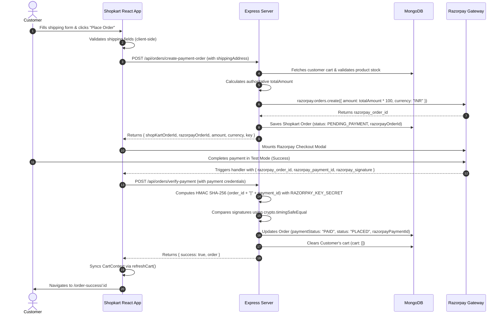

# 🛍️ Shopkart — Full-Stack E-Commerce Application

Shopkart is a modern, responsive full-stack e-commerce web application built using the **MERN** stack (MongoDB, Express.js, React, Node.js) with **Vite**, **Tailwind CSS**, and **Razorpay** payment gateway integration in Test Mode.

---

## 📑 Table of Contents

- [Project Overview](#-project-overview)
- [Key Features](#-key-features)
- [Tech Stack](#-tech-stack)
- [Project Architecture & Directory Structure](#-project-architecture--directory-structure)
- [Prerequisites](#-prerequisites)
- [Installation & Local Setup](#-installation--local-setup)
- [Environment Variables](#-environment-variables)
- [Database Models & Schema Design](#-database-models--schema-design)
- [API Documentation](#-api-documentation)
- [Razorpay Payment Lifecycle](#-razorpay-payment-lifecycle)
- [Local Testing & Verification Guide](#-local-testing--verification-guide)
- [Troubleshooting & Common Issues](#-troubleshooting--common-issues)
- [Security Best Practices](#-security-best-practices)

---

## 🌟 Project Overview

Shopkart provides a complete end-to-end shopping experience:
- Customers can browse a catalog of curated products, search in real-time, filter by category, sort by price, and inspect detailed product views.
- Registered customers can maintain a persistent wishlist and shopping cart with real-time stock checks.
- At checkout, shipping details are collected and validated, followed by a secure Razorpay checkout modal.
- Payments are cryptographically verified server-side using HMAC SHA-256 before orders are confirmed and the cart is cleared.
- Customers can track past orders with dedicated status badges in their personal order history.

---

## ✨ Key Features

### 🛒 Product Catalog & Discovery
- **Hero & Curated Showcase**: Highlights trending collections, featured categories, and best sellers on the home page.
- **Search & Filters**: Real-time case-insensitive keyword search by product name and category filtering (`Electronics`, `Fashion`, `Books`, `Home`).
- **Dynamic Sorting**: Price sorting in ascending (`price_asc`) and descending (`price_desc`) order.
- **Product Details Page**: Full product image showcase, description, category tag, real-time stock availability, and quantity selection.

### 🔐 Authentication & Session Management
- **Customer Registration**: Validates full name, email, phone number, and password with an interactive password strength indicator.
- **Secure Login**: Authenticates credentials using `bcrypt` password hashing and issues a JWT stored in an `HttpOnly` cookie.
- **Route Protection**: Dedicated `ProtectedRoute` and `PublicRoute` components for authenticated and guest navigation.
- **Account Dropdown**: Quick view of user profile information (name, email, phone) and one-click logout.

### ❤️ Wishlist & 🛍️ Cart
- **Persistent Wishlist**: Add and remove items with database persistence per customer account.
- **Interactive Cart**: Increment/decrement item quantities with real-time inventory validation against available stock in MongoDB.
- **Dynamic Calculation**: Accurate subtotal and item unit counters calculated dynamically across views.

### 💳 Checkout & Order Processing
- **Shipping Address Form**: Client-side validation for recipient name, phone number (10–15 digits), address line, city, state, and 6-digit postal pincode.
- **Razorpay Standard Checkout**: Dynamic loading of Razorpay's checkout script with prefilled customer details.
- **Server-Side Verification**: Timing-safe HMAC SHA-256 cryptographic verification of payment signatures (`crypto.timingSafeEqual`).
- **Automatic Cart Clearance**: Customer database cart is emptied only upon successful payment verification.
- **Order Confirmation**: Instant receipt page displaying order ID, itemized breakdown, shipping address, and live payment status.
- **Order History (My Orders)**: Dedicated `/orders` page listing placed orders in reverse chronological order with color-coded status badges (`Placed`, `Confirmed`, `Shipped`, `Delivered`, `Pending Payment`, `Cancelled`).

---

## 🛠️ Tech Stack

### Frontend
- **Framework**: [React 19](https://react.dev/)
- **Build Tool**: [Vite 8](https://vitejs.dev/)
- **Routing**: [React Router DOM v7](https://reactrouter.com/)
- **Styling**: [Tailwind CSS v4](https://tailwindcss.com/) with `@tailwindcss/vite`
- **Typography**: Google Fonts (*Playfair Display* & *Plus Jakarta Sans*)
- **HTTP Client**: [Axios](https://axios-http.com/) (configured with `withCredentials: true`)

### Backend
- **Runtime**: [Node.js](https://nodejs.org/) (ES Modules `"type": "module"`)
- **Server Framework**: [Express 5](https://expressjs.com/)
- **Database ODM**: [Mongoose 9](https://mongoosejs.com/)
- **Authentication**: [jsonwebtoken (JWT)](https://github.com/auth0/node-jsonwebtoken), [bcrypt](https://github.com/kelektiv/node.bcrypt.js), [cookie-parser](https://github.com/expressjs/cookie-parser)
- **Payment Processing**: [Razorpay Node SDK](https://github.com/razorpay/razorpay-node)
- **Cryptography**: Node.js built-in `crypto` module (HMAC SHA-256 and `timingSafeEqual`)
- **Development Tooling**: [Nodemon](https://nodemon.io/), [dotenv](https://github.com/motdotla/dotenv)

### Database
- **MongoDB**: Document database (MongoDB Atlas or local instance)

---

## 📂 Project Architecture & Directory Structure

```text
Shopkart/
├── frontend/                     # React + Vite Frontend
│   ├── public/                   # Static assets
│   ├── src/
│   │   ├── assets/               # Local images & icons
│   │   ├── axiosCalls/
│   │   │   └── axios.js          # Configured Axios instance (baseURL & withCredentials)
│   │   ├── components/
│   │   │   ├── Navbar.jsx        # Responsive navigation bar with badges & user menu
│   │   │   ├── ProductCard.jsx   # Reusable product card with wishlist & cart actions
│   │   │   ├── ProtectedRoute.jsx# Auth route guard for private pages
│   │   │   └── PublicRoute.jsx   # Route guard restricting access to guest-only pages
│   │   ├── context/
│   │   │   ├── AuthContext.jsx   # Authentication state, login, profile, and logout
│   │   │   ├── CartContext.jsx   # Cart state, add/update/remove, and inventory sync
│   │   │   └── WishlistContext.jsx# Wishlist state and ID tracking
│   │   ├── pages/
│   │   │   ├── Home.jsx          # Landing page with hero, categories, and curated lists
│   │   │   ├── Products.jsx      # Product catalog with search, filter, and sorting
│   │   │   ├── ProductDetails.jsx# Single product view with inventory details
│   │   │   ├── Wishlist.jsx      # Customer saved wishlist items
│   │   │   ├── Cart.jsx          # Shopping cart management and subtotal breakdown
│   │   │   ├── Checkout.jsx      # Shipping address form and Razorpay trigger
│   │   │   ├── OrderSuccess.jsx  # Post-payment order receipt and confirmation
│   │   │   ├── Orders.jsx        # My Orders history page with status tracking
│   │   │   ├── Login.jsx         # Customer login page
│   │   │   └── Register.jsx      # Registration page with password strength meter
│   │   ├── App.jsx               # Route definitions and Context provider hierarchy
│   │   ├── index.css             # Tailwind CSS entrypoint and font configuration
│   │   └── main.jsx              # React root DOM entrypoint
│   ├── index.html                # HTML document template
│   ├── package.json              # Frontend scripts and dependencies
│   └── vite.config.js            # Vite configuration with Tailwind CSS plugin
│
├── server/                       # Express + Node.js Backend
│   ├── config/
│   │   └── razorpay.js           # Razorpay instance initialization with credentials
│   ├── controllers/
│   │   ├── customer.controller.js# Register, login, profile (/me), and logout
│   │   ├── product.controller.js # Product CRUD, filtering, search, and sorting
│   │   ├── wishlist.controller.js# Add, remove, and retrieve wishlist items
│   │   ├── cart.controller.js    # Add, update quantity, remove, and populate cart
│   │   └── order.controller.js   # Razorpay order generation & signature verification
│   ├── middlewares/
│   │   └── auth.middleware.js    # JWT token verification (cookie / Bearer token)
│   ├── models/
│   │   ├── customer.model.js     # Customer schema with embedded cart and wishlist
│   │   ├── product.model.js      # Product schema with price, category, and stock
│   │   └── order.model.js        # Order schema with shipping address, items, and status
│   ├── routes/
│   │   ├── customer.routes.js    # /api/customers routes
│   │   ├── product.routes.js     # /products and /api/products routes
│   │   ├── wishlist.routes.js    # /wishlist and /api/wishlist routes
│   │   ├── cart.routes.js        # /cart and /api/cart routes
│   │   └── order.routes.js       # /orders and /api/orders routes
│   ├── utils/
│   │   └── generateToken.js      # JWT token generator with HttpOnly cookie setter
│   ├── seedProducts.js           # Database seeder script with initial product catalog
│   ├── index.js                  # Express server setup, CORS configuration, and DB connection
│   └── package.json              # Backend scripts and dependencies
│
└── README.md                     # Root project documentation
```

---

## 📋 Prerequisites

Ensure you have the following installed on your local machine:
- **Node.js**: v18.0.0 or higher ([Download Node.js](https://nodejs.org/))
- **npm**: v9.0.0 or higher (packaged with Node.js)
- **MongoDB**: A running local MongoDB daemon (`mongodb://localhost:27017`) or a free [MongoDB Atlas](https://www.mongodb.com/cloud/atlas) cluster URI.
- **Razorpay Account**: A free [Razorpay Dashboard](https://dashboard.razorpay.com/) account to generate **Test Mode** API Keys (`Key ID` and `Key Secret`).

---

## 🚀 Installation & Local Setup

### 1. Clone the Repository
```bash
git clone https://github.com/Astik-493/Shopcart.git
cd Shopcart
```

### 2. Configure the Backend

Navigate to the `server/` directory and install dependencies:
```bash
cd server
npm install
```

Create a `.env` file in the `server/` folder:
```bash
touch .env
```

Add your environment configuration into `server/.env` (see [Environment Variables](#-environment-variables) below for details).

#### Seed the Database with Sample Products:
Run the built-in seeder script to populate your MongoDB database with sample categories (Electronics, Fashion, Books, Home):
```bash
node seedProducts.js
```

#### Start the Backend Server:
```bash
npm run dev
```
The backend API server will start on `http://localhost:8001`.

---

### 3. Configure the Frontend

Open a new terminal tab, navigate to the `frontend/` directory, and install dependencies:
```bash
cd frontend
npm install
```

#### Start the Vite Development Server:
```bash
npm run dev
```
The frontend application will start on `http://localhost:5173`.

---

## 🔑 Environment Variables

### Backend Configuration (`server/.env`)

Create `server/.env` with the following variables:

| Variable | Description | Example / Default |
| :--- | :--- | :--- |
| `PORT` | Port number for the Express server *(Optional)* | `8001` |
| `dbUrl` | MongoDB connection string URI | `mongodb+srv://<user>:<password>@cluster.mongodb.net/shopkart` |
| `JWT_SECRET` | Secret key used for signing & verifying JWT tokens | `your_secure_jwt_secret_key_here` |
| `NODE_ENV` | Application environment mode | `development` or `production` |
| `RAZORPAY_KEY_ID` | Razorpay Test API Key ID from Razorpay Dashboard | `rzp_test_xxxxxxxxxxxxxx` |
| `RAZORPAY_KEY_SECRET`| Razorpay Test API Key Secret from Razorpay Dashboard | `xxxxxxxxxxxxxxxxxxxxxxxx` |

> [!WARNING]
> Never commit `.env` files or expose real API secrets, tokens, or database passwords in version control.

### Frontend API URL Configuration
The frontend communicates with the backend via [`frontend/src/axiosCalls/axios.js`](file:///Users/astik/Desktop/Shopkart/frontend/src/axiosCalls/axios.js), where the base URL defaults to `http://localhost:8001/` with `withCredentials: true` to support cross-origin cookie authentication.

---

## 🗄️ Database Models & Schema Design

### 1. Customer Model (`server/models/customer.model.js`)
- `fullName` *(String, required)*: User's full name.
- `email` *(String, required, unique, lowercase)*: User's login email.
- `password` *(String, required)*: Salted and hashed password via `bcrypt`.
- `phone` *(String, required)*: User contact number.
- `wishlist` *(Array of ObjectId, ref: 'Product')*: List of favorited product IDs.
- `cart` *(Array of Objects)*:
  - `product` *(ObjectId, ref: 'Product', required)*
  - `quantity` *(Number, required, min: 1)*
- `timestamps`: Automatically manages `createdAt` and `updatedAt`.

### 2. Product Model (`server/models/product.model.js`)
- `name` *(String, required, trimmed)*: Product title.
- `description` *(String, required)*: Comprehensive product details.
- `price` *(Number, required, min: 0.01)*: Product retail price in INR (₹).
- `category` *(String, required)*: Category taxonomy (e.g., Electronics, Fashion).
- `image` *(String, required)*: Product image URL.
- `stock` *(Number, required, min: 0)*: Available inventory units.
- `createdAt` *(Date, default: Date.now)*.

### 3. Order Model (`server/models/order.model.js`)
- `user` *(ObjectId, ref: 'Customer', required)*: Associated customer ID.
- `items` *(Array of Subdocuments, required)*:
  - `product` *(ObjectId, ref: 'Product')*, `name`, `price`, `quantity`, `image`.
- `shippingAddress` *(Subdocument, required)*:
  - `fullName`, `phone`, `address`, `addressLine1`, `city`, `state`, `pincode`.
- `totalAmount` *(Number, required, min: 0)*: Calculated order total in INR (₹).
- `status` *(String, enum)*: `PENDING_PAYMENT` (default), `PLACED`, `CONFIRMED`, `SHIPPED`, `DELIVERED`.
- `paymentStatus` *(String, enum)*: `PENDING` (default), `PAID`, `FAILED`.
- `razorpayOrderId` *(String)*: Unique Razorpay order identifier (`order_...`).
- `razorpayPaymentId` *(String)*: Unique Razorpay transaction identifier (`pay_...`).
- `timestamps`: Records order placement and modification timestamps.

---

## 🔌 API Documentation

### 👤 Customer & Authentication Endpoints (`/api/customers`)

| Method | Endpoint | Access | Description |
| :--- | :--- | :--- | :--- |
| `POST` | `/api/customers/register` | Public | Register a new customer account. |
| `POST` | `/api/customers/login` | Public | Authenticate customer and set `HttpOnly` JWT cookie. |
| `GET` | `/api/customers/me` | Protected | Fetch current logged-in customer profile. |
| `POST` | `/api/customers/logout` | Protected | Clear JWT cookie and terminate session. |

### 📦 Product Endpoints (`/products` or `/api/products`)

| Method | Endpoint | Access | Query Parameters / Description |
| :--- | :--- | :--- | :--- |
| `GET` | `/products` | Public | Get all products. Supports `?search=query`, `?category=Name`, and `?sort=price_asc\|price_desc`. |
| `GET` | `/products/:id` | Public | Retrieve detailed information for a single product by ID. |
| `POST` | `/products` | Public/Internal | Create a new product (requires `name`, `description`, `price`, `category`, `image`, `stock`). |

### ❤️ Wishlist Endpoints (`/wishlist` or `/api/wishlist`)

| Method | Endpoint | Access | Description |
| :--- | :--- | :--- | :--- |
| `GET` | `/wishlist` | Protected | Fetch authenticated user's populated wishlist items. |
| `POST` | `/wishlist/:productId` | Protected | Add a product to the authenticated user's wishlist. |
| `DELETE`| `/wishlist/:productId` | Protected | Remove a product from the wishlist. |

### 🛒 Cart Endpoints (`/cart` or `/api/cart`)

| Method | Endpoint | Access | Description |
| :--- | :--- | :--- | :--- |
| `GET` | `/cart` | Protected | Fetch authenticated user's populated shopping cart. |
| `POST` | `/cart/:productId` | Protected | Add a product to cart (or increment quantity with stock check). |
| `PATCH` | `/cart/:productId` | Protected | Update item quantity in cart (`{ quantity: Number }`). |
| `DELETE`| `/cart/:productId` | Protected | Remove a specific product item from the cart. |

### 💳 Orders & Payment Endpoints (`/orders` or `/api/orders`)

| Method | Endpoint | Access | Description |
| :--- | :--- | :--- | :--- |
| `GET` | `/api/orders` | Protected | Get all orders belonging to the authenticated customer (sorted newest first). |
| `GET` | `/api/orders/:id` | Protected | Get a specific order by its MongoDB ID (ownership verified). |
| `POST` | `/api/orders/create-payment-order` | Protected | Validate cart, check stock, instantiate DB order, and create Razorpay order. |
| `POST` | `/api/orders/verify-payment` | Protected | Verify HMAC SHA-256 signature, mark order as `PAID`/`PLACED`, and empty cart. |

---

## 🔄 Razorpay Payment Lifecycle

The application integrates Razorpay Standard Checkout in Test Mode through a secure, two-step server-verified process:



---

## 🧪 Local Testing & Verification Guide

### 1. Manual Testing Workflow
1. **User Sign Up**: Visit `/register` and create an account with a valid email and strong password.
2. **Catalog Browsing**: Navigate to `/products`. Test the search input, category filters (Electronics, Fashion, Books, Home), and price sorting options.
3. **Wishlist & Cart**:
   - Click the Heart icon on any card to add/remove from wishlist.
   - Click **Add to Cart** and visit `/cart` to adjust quantities or remove items.
4. **Checkout Form Validation**:
   - Go to `/checkout`.
   - Submit the form with missing or invalid fields to verify error messages.
5. **Razorpay Test Payment**:
   - Fill in valid shipping details and click **Place Order**.
   - When the Razorpay modal opens, select **Netbanking** -> **State Bank of India** (or any test bank).
   - Click **Pay Now** and choose **Success** on the Razorpay test bank page.
6. **Confirmation & Order History**:
   - Verify automatic redirection to `/order-success/:id`.
   - Confirm that the cart counter resets to `0`.
   - Visit `/orders` (via the **My Orders** link in the navbar) to verify the order is listed with the status **Placed** and payment status **Paid**.

> [!NOTE]
> There are currently no automated unit/integration test suites configured in `package.json`. Manual testing is performed through the UI and API endpoints.

---

## 🛠️ Troubleshooting & Common Issues

| Issue | Likely Cause | Solution |
| :--- | :--- | :--- |
| **`ERR_NETWORK` on Frontend** | Backend server is not running or running on an unexpected port. | Ensure backend is running via `npm run dev` inside `server/` on port `8001`. |
| **CORS / Cookie Authentication Error** | `withCredentials` missing or CORS origin mismatch. | Ensure `server/index.js` allows `http://localhost:5173` with `Access-Control-Allow-Credentials: true`. |
| **MongoDB Connection Failed** | Incorrect `dbUrl` in `server/.env` or MongoDB daemon stopped. | Verify your `dbUrl` string in `server/.env` and ensure your IP is whitelisted on MongoDB Atlas. |
| **Razorpay "Key ID not found" / Order Failure** | Missing or incorrect `RAZORPAY_KEY_ID` or `RAZORPAY_KEY_SECRET` in `server/.env`. | Check your Razorpay Dashboard in Test Mode and copy the exact `Key ID` and `Key Secret` into `server/.env`. |
| **"Invalid payment signature" on verification** | Secret mismatch or invalid Razorpay credentials. | Verify that `RAZORPAY_KEY_SECRET` in `server/.env` matches the Key Secret corresponding to `RAZORPAY_KEY_ID`. |
| **Cart is empty after page refresh** | Unauthenticated user session. | Log in at `/login` so the JWT token cookie is sent with subsequent requests. |

---

## 🔒 Security Best Practices

- **Strict Environment Isolation**: Credentials, database URLs, and JWT secrets are stored solely in `server/.env` and excluded via `.gitignore`.
- **Backend-Only Payment Secrets**: `RAZORPAY_KEY_SECRET` is never sent to the client or bundled into frontend assets.
- **Server Source of Truth**: Order totals and item prices are computed server-side directly from MongoDB product prices, preventing client-side price manipulation.
- **Cryptographic Signature Validation**: Payment authenticity is guaranteed using HMAC SHA-256 signatures with constant-time equality comparisons (`crypto.timingSafeEqual`) to prevent timing attack vulnerabilities.
- **Protected Cookie Storage**: Session JWT tokens are written as `HttpOnly` and `SameSite: strict` cookies, preventing unauthorized access via cross-site scripting (XSS).
- **Ownership Verification**: Customers can only inspect, verify, and retrieve orders and carts linked to their own authenticated database identifier.

---

## 📄 License

This project is licensed under the [ISC License](file:///Users/astik/Desktop/Shopkart/server/package.json).
